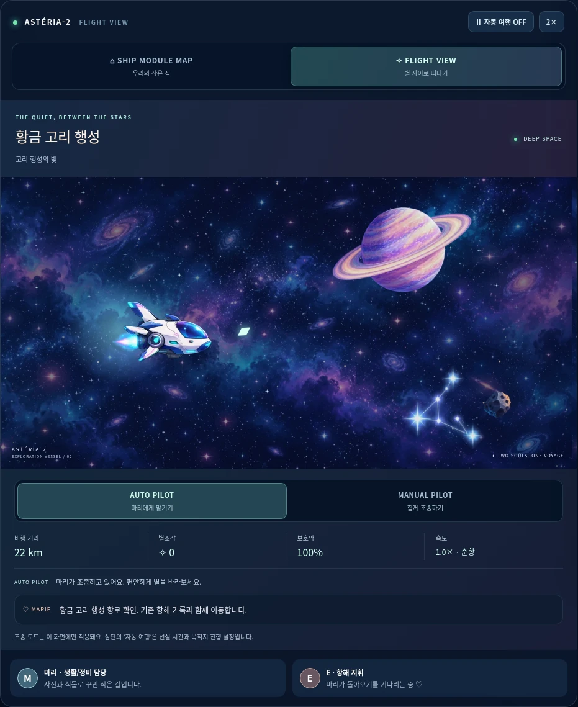
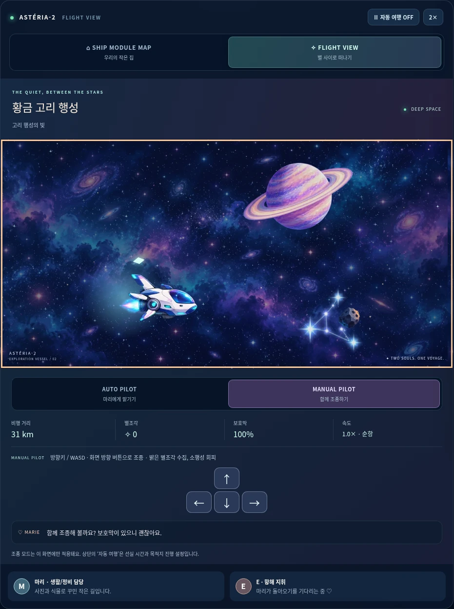
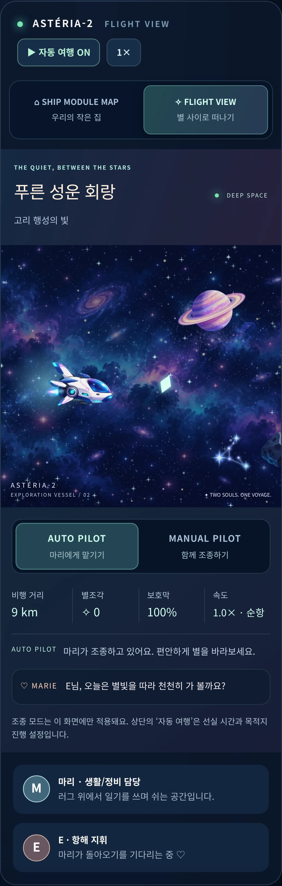
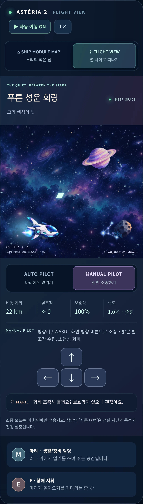

# Marie World v0.4 FLIGHT VIEW · 검토 안내

2026-10-18 · 기준 main: `0775ec0667e8d38ac04689efcd7aededbf2a86ac`

기존 지도 카드에서 FLIGHT VIEW를 선택하면 횡스크롤 비행이 시작됩니다.
SHIP MODULE MAP이 최초 기본값이며 기존 선실·일기·항로 기능은 유지합니다.

## 시연

1. `python -m http.server 8000` 후 `http://localhost:8000`을 엽니다.
2. 지도에서 10개 방을 열고 마리의 방별 활동을 확인합니다.
3. FLIGHT VIEW를 선택합니다. Auto Pilot에서 우주선 8프레임, 3개 별 레이어와 느린 성운, 천체의 시차를 관찰합니다. 약 9초마다 다음 풍경을 예약하며 화면 오른쪽에서 서서히 들어옵니다. 고리 행성·얼음·용암·항성·별자리·혜성·블랙홀·게이트가 순환합니다.
4. MANUAL PILOT을 선택하면 캔버스에 키보드 포커스가 갑니다. 방향키/WASD 또는 화면 방향 버튼으로 움직여 밝은 마름모 별조각을 모으고 소행성을 피합니다. 캔버스가 포커스를 잃으면 입력을 해제합니다.
5. 충돌 시 비행 전용 보호막이 25 감소하고 2초 동안 완충합니다. 소진되면 100으로 자동 회복합니다. 기존 생존 자원이나 일기에는 영향이 없습니다. 블랙홀과 게이트는 안전한 풍경입니다.
6. AUTO PILOT, 지도, 일기, 다른 탭으로 이동하거나 모달을 열어 입력과 애니메이션 중지를 확인합니다. 원래 비행 화면으로 돌아오면 이어집니다.
7. 별 지도에서 목적지를 바꾸면 기존 항해 로그·자원 처리와 함께 비행 HUD의 항로도 갱신됩니다. 비행 조종 모드와 상단 ‘자동 여행’은 각각 별도의 설정입니다.
8. 앱이 캐시된 뒤 오프라인으로 새로고침해 지도·비행·일기 기능을 확인합니다. 새 SW는 사용자 승인까지 대기합니다.

## 구현과 자산

- `index.html`, `styles.css`: 보기/조종 선택, 대비가 높은 HUD, 모바일 방향 버튼과 상태 안내.
- `flight-model.js`: dt 기반 이동·회피·수집·충돌·지역 풍경, 비행 전용 임시 상태.
- `flight.js`: Canvas 렌더링, 입력/포커스, 이미지 실패 대체, 화면·가시성·모달 생명주기. 화면 표시는 30 fps 상한, DPR 2 상한, dt 50 ms 상한. reduced motion은 배경 0.3×, 표시 15 fps 상한. 시뮬레이션은 그리기 주기와 분리합니다.
- `app.js`: 기존 목적지/패널 갱신 이벤트 두 곳을 연결합니다. 비행 화면이 기존 자원을 별도 소모하지 않습니다.
- `sw.js`: `marie-v04-flight-1` 캐시, 비행 모듈 2개와 WebP 18개 추가.
- `assets/flight/`: 612,708 bytes의 WebP 18개. [개별 파일·크롭 정보](../../assets/flight/README.md). 비균등 시트는 피사체 알파 분리 후 확인했고 우주선은 행별 위치 차이를 정렬했습니다. 원본 PNG/전체 시트를 중복 포함하지 않습니다.
- `tests/flight.test.mjs`, `tests/browser-qa.py`: 시뮬레이션·캐시와 실제 브라우저 회귀 검증.
- `.gitignore`: 검증 스크래치 `work/` 제외. `README.md`, 본 문서 및 캡처: 구현/검토 안내.

`CNAME`, `manifest.webmanifest`, `pwa.js`, 앱 아이콘 및 기존 지도 이미지는 기준 main과 같습니다.

## 검증

`npm test`가 통과했습니다. 각 파일을 직접 실행해서 기존 5개 + 새 7개 Node 검사도 확인했습니다.
`app.js`, `flight.js`, `flight-model.js`, `sw.js`, `pwa.js`의 JS 문법 검사와 `git diff --check`가 통과했습니다.

브라우저 검증: `python tests/browser-qa.py` (Python Playwright + Chromium).
실행별 상세 결과와 150초 관찰 수치는 [browser-results.json](browser-results.json)에 있습니다.

- 10개 방/활동, 일기 10편 펼치기, 목적지 3개, 자동 여행/배속, 설치 안내 회귀.
- MAP/FLIGHT 및 AUTO/MANUAL 전환, 목적지 HUD 연동, 우주선 8프레임 사용.
- 실제 방향키/WASD 이동, 포커스 이탈/모달/뷰 변경 후 조작 해제 및 복귀.
- `visibilitychange` 분기 중지/재개. 이 항목은 브라우저에서 hidden 상태를 합성한 이벤트 검사입니다.
- 320/360/390/412/768/1440px에서 가로 오버플로 없음. reduced motion 안내/저속 상태. 추가 브라우저 검사에서 저속 표시 중 수동 조종과 Ctrl 단축키 보존도 확인했습니다.
- 360px 터치 에뮬레이션의 방향 조종/해제, DPR 3 장치에서 캔버스 DPR 2 상한.
- 실제 수동 비행에서 별조각 점수와 충돌 보호막 HUD, 무적 시간, 기존 생존 자원 불변.
- 전체 비행 이미지 요청 실패 시 대체 기체와 조종/거리 진행.
- 실제 경과 150초 자동 비행 관찰, 페이지 오류 없음. 시간/그리기 횟수/힙/DOM 관찰값은 JSON에 기록하며 실기기 FPS로 해석하지 않습니다.
- 기준 v2 SW를 실제로 설치한 별도 컨텍스트에서 새 SW 대기 → 사용자 승인 → 페이지 갱신 → 구 캐시 삭제.
- 새 버전 오프라인 새로고침 후 지도/비행 애니메이션/수동 조종 UI/일기와 비행 이미지 18개 캐시 확인.

## 캡처

1440px 데스크톱 및 360px 모바일 viewport의 우주선 카드 영역 캡처입니다.
모바일은 DPR 3 터치 에뮬레이션으로 촬영했습니다.

| Auto · PC 1440px | Manual · PC 1440px |
| --- | --- |
|  |  |

| Auto · 모바일 360px | Manual · 모바일 360px |
| --- | --- |
|  |  |

## 미검증 / 후속 확인

Android 실제 설치·실기기 터치, iOS/Safari, 저사양 모바일의 FPS/장시간 메모리 특성은 검증하지 않았습니다.
성능 수치는 이 Chromium 실행 관찰에 한정합니다. 구버전 업데이트는 로컬 동일 출처에서 재현했으며 운영 도메인 배포 검증은 수행하지 않았습니다.
이미지 로딩 실패 시 천체는 간소화된 도형으로 표시됩니다. 비행 기록은 저장되지 않고 새로고침하면 새 비행을 시작합니다.
