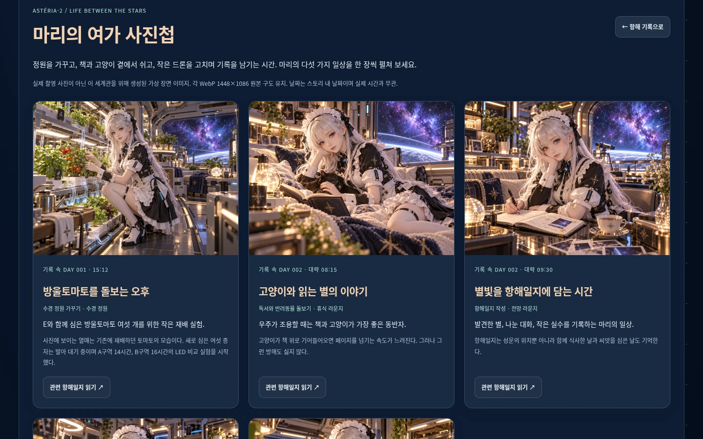
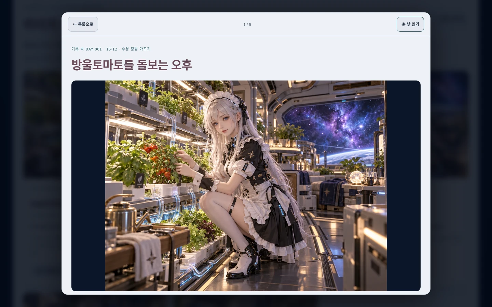
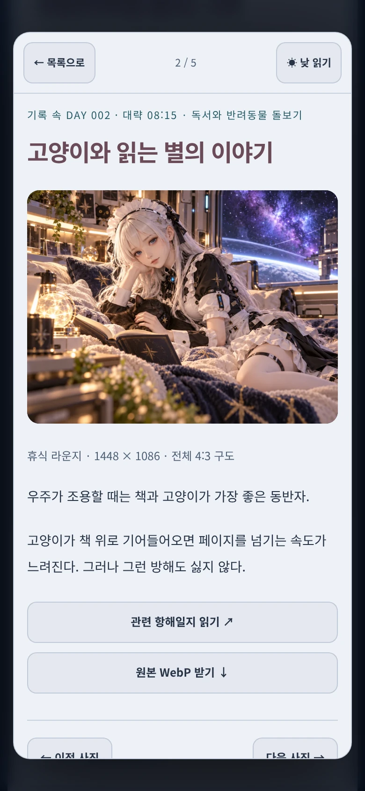

# 마리의 여가 사진첩 / VOYAGE 002 검토

기준 main: `03a57d20e1e549ad798d11e1ae30825d54a150b5`.
001 삽화를 전체 패널로 보존한 후속 수정까지 반영된 main에서 분기했습니다.

항해 일기 → E와 함께한 항해에 002권을 추가하고 **마리의 여가 사진첩 · 5장** 진입점을 제공합니다.
원래 001이 첫 권으로 유지되고 권 선택에서 001/002를 오갈 수 있습니다.
선실 방 버튼이나 게임 우선순위는 바꾸지 않고 항해 기록 영역 안에 사진첩을 배치했습니다.

## 콘텐츠와 화면

- 독립 원본 5개는 1448×1086 WebP, 총 **1,299,404 bytes**. 모든 축소/확대 화면에서 4:3 구도를 유지합니다.
- 동일 사진의 일지용 960×540 프레임 5개 + 커버 1개를 포함한 새 WebP 11개는 **1,955,794 bytes**입니다. 11개 서로 다른 사진이라고 표시하지 않습니다.
- 002 일기 5편, 정전 메모, 갤러리/자산 JSON과 모든 WebP는 제공 파일 그대로입니다. [용량·해시·출처](ASSETS.md).
- 002 레지스트리는 원본 객체를 정확히 한 번 추가했습니다. 기존 001 레코드를 교체하거나 수정하지 않았습니다.
- 카드에 제목·활동·장소·설명·이야기 속 날짜를 표시하고, 독립 확대 창과 원본 다운로드를 제공합니다.
- 일지에서 원본 사진으로, 사진에서 해당 일지로 양방향 이동합니다. 서로 다른 배열 순서를 `diary_image`로 연결합니다. [연결표/관리 안내](AUTHORING.md).
- 기존 native dialog를 공유해 중첩 모달을 만들지 않습니다. 이전/다음, Tab/Escape, 원래 버튼의 포커스와 스크롤 복귀, 낮/밤 읽기, 터치와 lazy loading/이미지 실패 문구를 유지합니다.

## 정전 / 기존 기능 보존

001의 본문/정전/이미지 16개/메타데이터와 레지스트리 객체는 기준 main과 같습니다.
`app.js`, 기존 일기 10편, 비행/방 게임/자원/항로 로직, `pwa.js`, CNAME, .nojekyll, manifest, 아이콘은 변경하지 않았습니다.

002의 DAY 002 일상과 항법 스냅샷을 구분합니다. 거리 2,037,120 km, 가정 속도 12 km/s, 약 47시간 9분은 **DAY 001 14:58 마지막 관측**이며 라이브 자원/거리 계산과 연결하지 않습니다.
새 토마토 씨앗 6개의 발아/수확은 미확정이고 사진의 익은 열매는 기존 작물입니다. 고양이 이름·드론 완전 수리·스쿨드/아공간의 추가 능력을 확정하지 않았습니다.
사진 메타데이터/공개 소개에서 인물의 비밀을 폭로하지 않으며 완전한 작가 정전은 스포일러 안내 뒤에 별도로 받습니다.

새 사용자 입력/DB/계정/브라우저 저장/외부 API는 없습니다. 현재 페이지의 읽기 선택/테마만 메모리에 유지합니다.
사진은 사용자가 제공한 세계관용 생성 이미지입니다. 실제 촬영/실험 증거가 아니며 실제 사용자 개인정보나 대화 원문을 추가하지 않았습니다.

## 검증

- `npm test`: 기존 33 + 신규 8 = **41개 검사 통과**. 002 한 번 등록, 5편 순서, 사진/일지 조인, 경로/크기 검증, 11개 원본 해시, 001 불변성, 오프라인 목록을 확인합니다.
- `node tests/leisure.test.mjs`, `node tests/voyage.test.mjs`, JS 문법 검사와 `git diff --check` 통과. 별도 lint/type/build 파이프라인은 없습니다.
- `python tests/leisure-browser-qa.py`: [사진첩/002/PWA 결과](browser-results.json). 5편 전체 본문/16:9, 독립 사진 5개/4:3, 다섯 양방향 링크, 원본 다운로드, Tab/ESC·포커스 복귀, 12회 재진입, 이미지/메타데이터 오류 복구를 확인했습니다.
- 1440×900 PC, 768×1024 태블릿, 390×844 모바일에서 터치·테마·가로 전환·가로 오버플로·reduced motion을 확인했습니다. 모바일/태블릿은 Chromium 에뮬레이션입니다.
- `MARIE_VOYAGE_QA_OUTPUT=work/leisure-v001-regression python tests/voyage-browser-qa.py`: 기존 001 읽기/기존 일기 10편/테마/복사/다운로드/오프라인·PWA **12그룹 통과**. [001 회귀](voyage-regression.json).
- `MARIE_ROOMS_QA_OUTPUT=work/leisure-rooms-regression python tests/rooms-browser-qa.py`: 방 10개 전체 플레이·결과·재시작/복귀, 러너 성공/실패, 반복 루프/입력 해제, 오프라인 **19그룹 통과**. [방 회귀](rooms-regression.json).
- 비행 회귀의 수동 이동 확인은 임의 Auto 위치가 화면 경계에 있지 않도록 먼저 이동 공간을 확보하고, 이미지 실패 후 거리 진행은 고정 600ms 대신 실제 상태를 기다리도록 보강했습니다. 브라우저의 전경 포커스를 확보하고 좌표/수집/충돌 상태를 기다리도록 했습니다. 제한된 headless 환경의 dt 상한 때문에 6초 실경과가 약 2.4초 시뮬레이션인 경우를 확인했으며, 게임 코드는 바꾸지 않았습니다. 최종 **11그룹이 통과**했으며 실제 150초 연속 Auto 비행에서 기체 그리기 3,340회·페이지 오류 0을 관찰했습니다. 이는 해당 headless 실행 관찰값으로 실기기 FPS 측정이 아닙니다. [비행 회귀](flight-regression.json)에 기록했습니다.
- 정상 실행의 브라우저 예외/HTTP 오류는 0입니다. 의도적인 503/이미지 요청 중단은 오류 복구용 별도 컨텍스트에서 검사합니다.

## 병합 검토 보완 · 2026-11-01

느린 사진첩 메타데이터 응답을 기다리는 동안 우주선 화면 또는 기존 마리 일기로 이동한 뒤 돌아오면, 사진첩이 빈 상태로 남는 문제를 재현했습니다. 유효한 요청의 결과는 숨겨진 상태에서도 렌더링하고, 포커스·스크롤 이동은 사진첩이 실제로 열린 화면에서만 수행하도록 수정했습니다.

- 홈 화면 및 기존 일기로 이동한 두 경로 모두 응답 완료 후 사진 5장이 표시되며, 배경 로딩이 현재 포커스를 빼앗지 않는 것을 확인했습니다.
- 최종 `npm test` 41개, 사진첩/002/PWA 브라우저 12그룹, 기존 001 브라우저 12그룹이 통과했습니다. [사진첩 최종 결과](browser-results.json)에 지연 응답 복귀 검증을 추가했습니다.
- 사진 원본·일기 본문·001 자산·게임/비행 로직은 변경하지 않았습니다.

## PWA

`marie-v07-leisure-1`로 버전을 올리고 새 코드/CSS, 원본 5개/프레임 5개/커버, 갤러리·자산 JSON·002 본문/메모를 프리캐시합니다.
기준 **marie-v06-voyage-2 설치 → 001 읽기 중 새 worker 대기 → 열린 글 유지 → 사용자 승인 → 새 UI·구 캐시 삭제**를 로컬 같은 출처에서 검증했습니다.
새 버전의 실제 오프라인 새로고침 이후 002 5편·원본 5개·양방향 링크, 001 12편·기존 일기 10편, 방 10개 시작과 Auto/Manual 비행·항로·자원 표시를 확인했습니다.

첫 온라인 준비/캐시 완료가 필요합니다. 이전 사용자 승인 기반 갱신을 유지하고 승인을 받기 전에 강제 새로고침하지 않습니다.

## 대표 캡처

| PC 사진첩 | PC 4:3 확대 |
| --- | --- |
|  |  |

| 태블릿 768×1024 | 모바일 390×844 |
| --- | --- |
|  |  |

## 제한

실제 Android/iOS 설치·물리 터치·Safari·스크린리더·저사양 성능·운영 도메인 업데이트는 미검증입니다.
프레임/원본 크기·터치·키보드·테마·PWA는 Chromium과 로컬 같은 출처에서 검사했습니다. 스와이프 이동은 추가하지 않았으며 이전/다음 버튼으로 탐색합니다.
날짜/일과는 고정 창작 기록이며 새 기록은 JSON/이미지·검토 PR로 관리합니다. 자동 대화 기록/ChatGPT 메모리 동기화는 없습니다.

main 직접 push·병합·운영 배포·설정/DNS 변경은 수행하지 않습니다.
