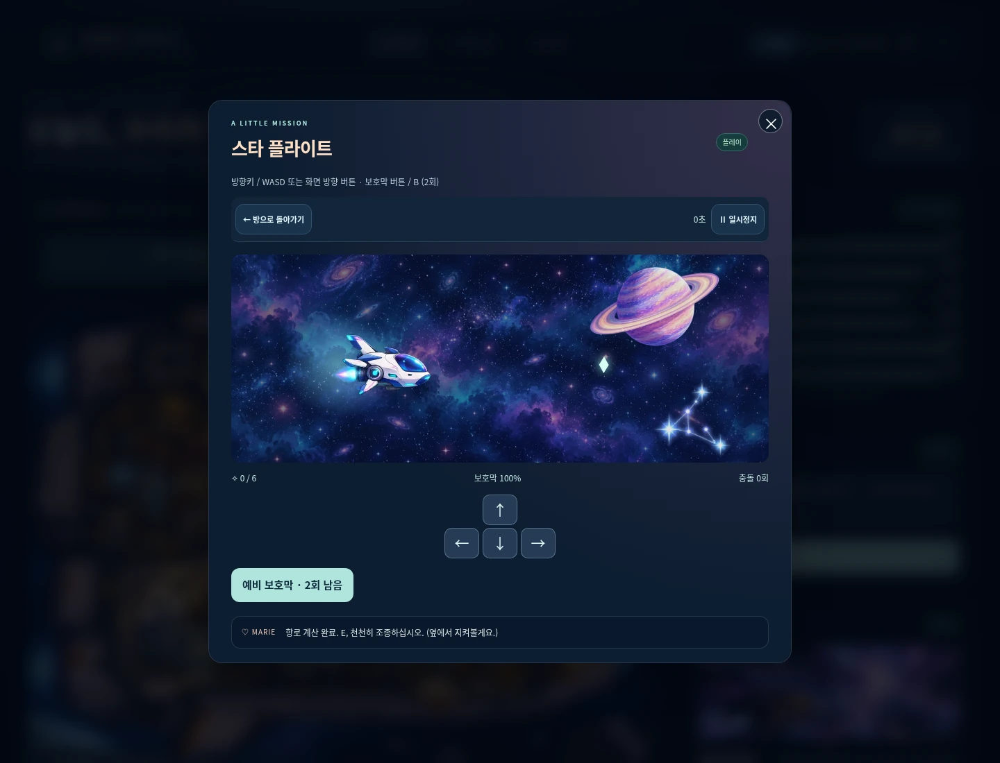
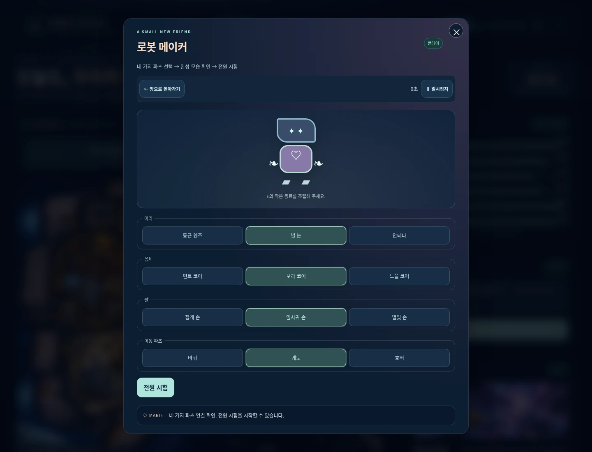
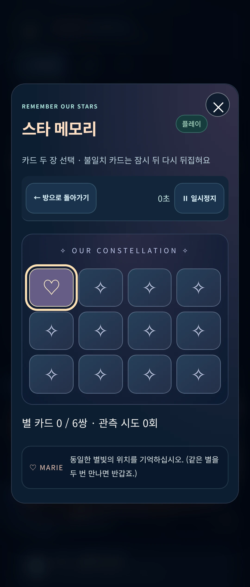
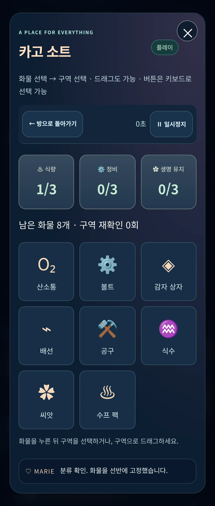

# ASTÉRIA-2 · 열 개의 방 이벤트

기준 main: `75c66b78248bc206bbcc58c1ecba34090c229e57` (기존 PWA/FLIGHT VIEW 병합 후).

이전에는 방의 함께하기/다른 방 이동이 중심이었습니다. 이제 각 방에 게임명·목표와 이벤트 버튼이 있고,
안내 → 시작 → 플레이 → 결과 → 재시작/방 복귀가 이어집니다. 기존 함께하기와 이동은 유지합니다.

## 방별 구현·검증

| 방 / ID | 게임과 판단·조작 | 완료 / 실패 | 실제 UI 검증 |
| --- | --- | --- | --- |
| 조종실 / cockpit | 스타 플라이트 · 방향키/WASD/터치 방향 버튼, B/예비 보호막 2회, 수집·회피 | 45초 생존 또는 6개 수집 / 보호막 소진 | 45초 생존 결과·보호막 사용·재시작/복귀. 수집·충돌·무적·실패는 공유 모델 검사 및 기존 비행 UI 회귀도 확인 |
| 수경 정원 / garden | 그로우 가든 · 씨앗별 물·빛 범위, 부족/과잉, 3단계 성장 | 균형 30초 후 직접 수확 / 불균형 35초 | 바질 물 65·빛 45 → 3단계 → 실제 수확·결과·재시작/복귀 |
| 주방 / kitchen | 코지 갤리 쿠킹 · 물→감자→바질, 6초 간격 초록 게이지 젓기 3회 | 30초 이후 완성 / 90초 안전 정지 | 잘못된 순서 거부, 올바른 젓기 3/3, 수프 평가·재시작/복귀 |
| 공방 / workshop | 로봇 메이커 · 머리/몸체/팔/이동 각 3종, 모습 반영·전원 시험 | 네 종류 연결·3초 부팅 / 누락 안내 | 누락 안내 → 네 종류 선택 → 시험 결과·재시작/복귀 |
| 엔진실 / engine | 리액터 튠 · 움직이는 게이지, 다른 목표의 회로 4개 | 3개 이상 안정 성공 / 2개 이하 보조 출력 | 실제 바늘/목표로 4/4 안정화 결과·재시작/복귀 |
| 관측실 / observatory | 스타 메모리 · 섞인 카드 12장, 불일치 0.9초, 시도 수 | 6쌍 전부 찾기 | 카드 위치를 직접 관측하며 6쌍/7회 결과·재시작/복귀 |
| 침실 / bedroom | 드림 셋업 · 취향에 맞는 조명/담요/쿠션, 실시간 미리보기·휴식도 | 세 요소 선택 후 쉬기 / 취향 부족 시 재조정 결과 | 제시 취향 조합 휴식도 100%·재시작/복귀 |
| 화물칸 / cargo | 카고 소트 · 9개 화물, 탭/키보드 선택→구역, 드래그 대안 | 올바르게 9개 분류 / 오답은 화물을 유지 | 오답 안내, 9개 정리 결과·재시작/복귀, 모바일 실제 터치 에뮬레이션 |
| 복도 / corridor | 패트롤 런 · 자동 러너, 상자 점프/배관 낮추기, 미리보기 ETA, 완충 | 45초/270m 순찰 / 완충 3회 소진 | 실패 결과와 270m 성공 경로, 재시작/복귀. 성공 시 장애물 14회 회피·완충 0회 |
| 거실 / lounge | 티타임 모먼트 · 찻잎, 25/30/35초 직접 우림 정지, 간식 조합 | 실제 우림·간식 후 추억 카드 / 100초 안전 정지 | 녹차 25.1초·쌀과자 → 향 평가/창작 대화·재시작/복귀 |

방별 성공·오답·실패·정지 규칙은 `tests/room-events.test.mjs`의 13개 검사에서도 검증합니다.
꾸미기형은 자유롭게 완료하며, 퍼즐/분류형은 불필요한 대기를 강제하지 않습니다.

## 공유 구조와 상태

- `room-events.js`: 기존 방 모달 안에서 이벤트 영역만 교체합니다. 별도 중첩 모달이 없습니다. 한 세션/한 RAF, 시작·일시정지·결과·재시작·종료, 포커스 트랩, 배경 inert, 입력 해제를 담당합니다.
- `room-models.js`: 서로 다른 10개 규칙, dt 상한 50ms, 완료 후 입력/시간 무시. 보상 경제나 자원 지급 경로를 추가하지 않습니다. 기념 점수/카드는 세션 내 결과로만 한 번 확정됩니다.
- `room-games.js`/`room-events.css`: 조작 가능한 HTML과 상태별 CSS/Canvas 연출. 터치 영역 44px 이상, 드래그 외 탭/키보드 대안, reduced motion, 작은 화면에서 고정되는 복귀/정지 도구 모음.
- `flight-scene.js`: 기존 렌더러를 이동하여 홈과 조종실에서 공유합니다. 기존 `FlightModel`도 재사용하며, 미션만 보호막 자동 회복을 끕니다. 집안 항해를 켜 둬도 방 모달 뒤의 홈 비행 루프는 정지합니다.
- 타이머/메모리 불일치 해제/성장/우림/부팅은 모두 세션의 경과 시간으로 계산합니다. 게임별 `setInterval`·`setTimeout`·오디오 루프가 없습니다.
- Escape/닫기는 이벤트 → 방 → 지도 순으로 한 단계씩 처리합니다. 탭 숨김/창 포커스 상실 시 자동 정지하며, 복귀 후 계속하기로 재개합니다. 다른 방 이동/메인 화면 전환은 종료하고 입력/뷰 구독을 정리합니다.
- 기존 자원·자동 항해는 기존 로직을 사용합니다. 게임이 자원을 중복 소모하거나 지급하지 않습니다. 일기 10편은 고정 창작 콘텐츠이고 새 사용자 입력·브라우저 저장을 추가하지 않습니다. 공개 호칭은 E로 정리했습니다.

## 명령과 실제 결과

- `npm test` 통과: 기존 smoke 5개 + 비행 7개 + 방 이벤트 13개, 합계 25개 규칙/회귀 검사. 개별 출력은 `node tests/smoke.test.mjs`, `node tests/flight.test.mjs`, `node tests/room-events.test.mjs`로 확인했습니다.
- `node --check`로 app/flight/flight-model/flight-scene/room-events/room-models/room-games/pwa/sw 9개 JS 파일 문법 검사 통과.
- `git diff --check` 통과. 이 정적 저장소에는 별도 lint/type/build 명령이 없어 이를 실행했다고 보고하지 않습니다.
- `python tests/rooms-browser-qa.py`: [브라우저 결과](browser-results.json). 10개 방을 실제 UI 입력으로 플레이·결과·재시작·복귀, 추가 러너 성공, 12회 반복 진입, 입력 해제, 포커스/일시정지/다른 방/리사이즈를 검사합니다. 각 플레이의 게임 시간은 Playwright 가상 시계로 실제 RAF 콜백을 진행한 것이며 실경과 45초 성능 측정이 아닙니다.
- 12회 반복에서 플레이 중 RAF 1개, 종료 후 0개. 홈 FLIGHT와 미션을 오갈 때도 활성 루프 1개만 확인했습니다. 기존 생존 자원은 자동 여행을 끄고 전후 값이 같음을 확인했습니다.
- 1440px PC, 360·390px 모바일 세로, 모바일 가로 전환. 실제 CDP 터치로 화물 선택/방향 조종/취소, 키보드 카드 선택. 모바일은 Chromium 에뮬레이션이며 실기기와 구분합니다.
- `MARIE_QA_OUTPUT=work/rooms-flight-regression python tests/browser-qa.py`: 기존 FLIGHT 전체 회귀 및 실제 경과 150.1초 자동 비행 통과. 페이지 오류 0, 기체 그리기 4,404회. [비행 회귀 결과](flight-regression.json). 해당 실행 관찰값이며 실기기 FPS 수치가 아닙니다.
- 브라우저 예외와 자산 404 없이 완료했습니다.

## PWA

`marie-v05-rooms-1`로 캐시를 갱신하고 새 모듈/핵심 CSS를 전체 프리캐시에 포함했습니다.
최초 준비는 온라인에서 서비스워커 설치/캐싱이 끝나야 합니다. 이후 실제 오프라인 새로고침 상태에서 10개 게임 모두 시작하고 진행이 가능한 것을 확인했습니다.

기준 v04 서비스워커를 같은 로컬 출처에 실제 설치 → 새 SW 대기 → 기존 페이지가 유지됨 확인 → 사용자 승인 → 새 버전 활성화/구 캐시 삭제 → 새 게임 오프라인 실행 순서를 검증했습니다.
기존 v2 → 현재 버전 경로도 비행 회귀 스크립트에서 통과했습니다.
`pwa.js`, manifest, 아이콘, CNAME, 기존 이미지 파일은 기준 main과 같습니다. 업데이트가 자동으로 게임을 새로고침하도록 변경하지 않았습니다.

## 캡처와 자산

새 런타임 이미지/음원은 0 bytes입니다. 기존 방·기체·스프라이트를 재사용하고 새로운 상태 표현은 직접 작성한 CSS/Canvas입니다. [파일별 크기/출처](ASSETS.md).
아래는 실제 브라우저 1440px PC / 360px 모바일(DPR 3) 대표 화면입니다.

| PC 조종실 미션 | PC 로봇 조립 |
| --- | --- |
|  |  |

| 모바일 카드 기억 | 모바일 화물 분류 |
| --- | --- |
|  |  |

## 확인한 문제와 해결

같은 비행 엔진이 복제되지 않도록 렌더러를 먼저 공유 모듈로 분리했습니다.
화물 드래그 시작 시 DOM 재생성이 드래그를 취소하지 않도록 선택 갱신을 분리했습니다.
완료·매칭 뒤 포커스를 유효한 버튼으로 옮기고, Escape가 부모 방까지 한꺼번에 닫지 않게 처리했습니다.
부분 조립 오류 후 완성된 로봇에도 누락 안내가 남던 문구를 현재 파츠 상태에 맞게 갱신했습니다.
복도 장애물 안내는 장애물이 완전히 지나갈 때까지 유지하여 배관 아래에서 너무 일찍 일어나는 일을 줄였습니다.

## 미검증 / 제한

Android 실제 설치/실기기 터치, iOS/Safari, 저사양 기기 FPS/오랜 메모리 관찰, 운영 도메인에서의 업데이트는 미검증입니다.
탭 가시성 검사는 합성 hidden 상태로 이벤트 분기를 확인했습니다. 창 포커스 상실도 자동 정지 코드 경로를 사용합니다.
화물 드래그는 선택 사항이며 전체 완료는 탭/키보드 경로로 검증했습니다. 게임은 무음이며 새 오디오 기능은 없습니다.
기념 점수/진행/카드는 저장하지 않아 새로고침하면 초기화됩니다. 이 동작이 기존 일기나 항해 저장 데이터를 변경하지 않습니다.

작업 브랜치에서만 커밋/push하고 OPEN PR을 제출합니다. main 직접 push·병합·운영 배포·설정/DNS 변경은 수행하지 않습니다.
