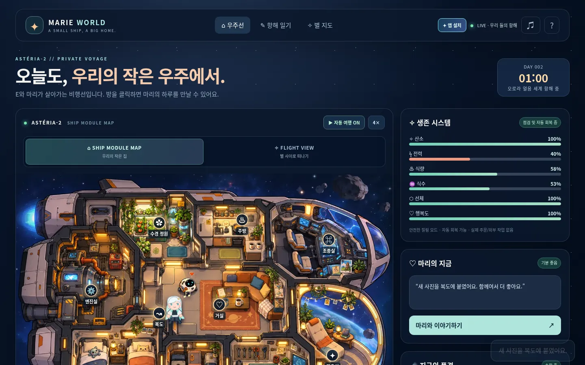
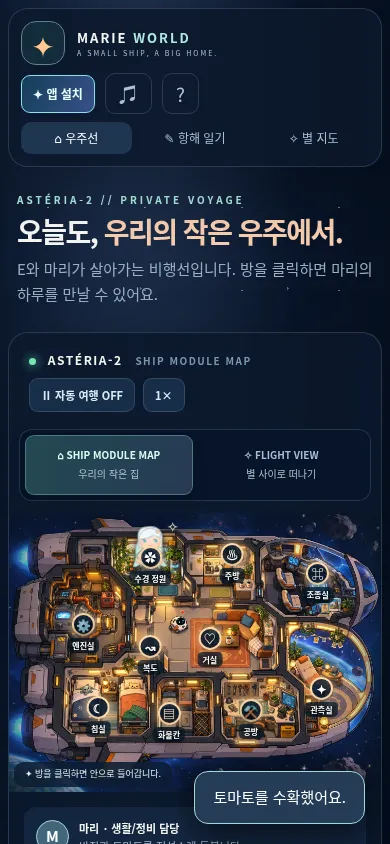

# PR01 — 공통 상태와 기존 힐링 어댑터

## 구현

`game/game-state.js`는 schemaVersion 1, scope `play-session`과 day/minute/mode/stats/crew/missions/research/modules/session/playLog를 소유합니다. 초기 값과 legacy snapshot은 기존 `app.js`와 일대일 대응합니다. 정적 일기/항해 데이터는 모델로 읽거나 쓰지 않습니다.

`game/game-events.js`는 ResourceChanged, CrewActionCompleted, MissionCompleted, ModuleConstructed의 엄격한 필드/ID/방/유한 수치 검사를 정의합니다. 순수 reducer는 입력을 변경하지 않으며 깊게 동결된 결과만 반환합니다. 동일 event ID는 같은 상태를 반환하고 중복 보상/알림을 하지 않습니다. 표현용 playLog는 최근 24개, 처리 ID는 세션 전체 동안 유지합니다. 현재 페이지를 새로 열면 초기화되며 저장하지 않습니다.

`game/legacy-adapter.js`가 상태를 closure 안에 보관합니다. 화면은 동결된 legacy projection을 읽고, 기존 시간/항로/자원/피드 변화는 복제된 draft를 검증한 뒤 한 번 교체합니다. 방의 함께하기는 실제 CrewActionCompleted 이벤트를 보냅니다. 기존 자동 여행이 마리를 다른 방으로 이동시킨 동안 열린 방의 행동을 누를 수 있던 동작도 보존합니다. 행동의 방은 lastActionRoom으로 기록하고 기존 지도 위치를 몰래 바꾸지 않습니다.

자원은 기존 15–100/반올림, 자동 회복, 기존 행동 효과를 유지합니다. 기본 `newEconomy:false`로 임무/건설 이벤트 처리를 차단합니다. 코드 수준의 opt-in 계약 테스트만 있으며 생존 모드, 실제 생산률, 연구·건설 UI, 게임 보상 연결은 후속 PR05–07 범위입니다. 비행 모델과 방 미니게임의 물리/점수는 계속 독립이며 이 PR에서 바꾸지 않았습니다.

모델에 wall clock/Math.random/DOM 의존성이 없습니다. 기존 UI의 랜덤 방 선택과 tick 간격은 그대로이고 adapter ID 생성기는 테스트 인수로 주입할 수 있습니다. app.js는 import를 위해 ES module로 전환했습니다. PWA는 새 세 모듈과 app을 동일 버전 `marie-v2-state-1`로 제공합니다. pwa.js의 사용자 승인 흐름은 그대로입니다.

## 검증 방법

- 변경 전 `npm test` 통과. 변경 후 npm test와 각 `tests/*.test.mjs` 직접 실행: 기존 41 + 신규 10 = 51개 검사. 런타임의 npm 요약은 테스트 파일 6개로 표시하므로 개별 실행의 실제 case 수도 확인했습니다.
- JS 문법과 `git diff --check` 검사.
- `python tests/v2-state-browser-qa.py`: 실제 baseline/current 화면에 같은 난수 seed와 가상 시계를 사용합니다. 10개 함께하기, 3개 항로 이동, 140회 자동 tick(날짜 넘김/행동/회복 포함)의 **155개 UI 스냅샷을 정확히 비교**합니다. 수치·날짜·시각·지도 위치·활동·대사·피드·항로·자동/속도 버튼이 같습니다.
- 실제 current main v0.7 worker → state worker 업그레이드: 열린 001 글을 유지한 채 승인 대기 → 사용자 버튼으로 갱신 → offline reload 후 module graph와 실제 방/항로 수치 변경 확인.
- 1440×900, 768×1024, 390×844의 기본 화면·터치·축소 동작·오버플로 확인. 태블릿/모바일은 Chromium 에뮬레이션입니다.
- 기존 flight/rooms/voyage/leisure 브라우저 QA를 별도 실행하며 최종 결과 파일을 이 디렉터리에 첨부합니다. 각 결과에서 확인 범위를 확인할 수 있습니다.

## 보존 경계와 한계

001/002 JSON·정전·이미지, 여가 사진첩, 기존 일기 10편 literal, 기존 비행과 방 게임 코드, CNAME/.nojekyll/manifest/icons/pwa.js는 baseline과 같습니다. 기존 고정 스냅샷은 게임 날짜/항로 이동의 영향을 받지 않습니다. 새 입력/계정/DB/API/로컬 저장/원격 전송은 없습니다.

실제 Android/iOS/Safari/스크린리더/저사양 성능/운영 도메인 설치·갱신은 미검증입니다. Node와 Chromium 로컬 서버에서 검증했으며 실기기 FPS나 운영 배포 성공을 주장하지 않습니다. 새 자원 생산·미션·건설·저장은 완성된 기능이 아닙니다.

## 결과 파일 / 화면

[상태·업그레이드 5그룹](state-results.json), [사진첩/002 12그룹](leisure-results.json), [001 12그룹](voyage-results.json), [방 19그룹](rooms-results.json)을 통과했습니다. [비행 11그룹](flight-results.json)도 통과했습니다. 실제 150초에서 기체 그리기 3,646회, 페이지 오류 0을 관찰했으며 실기기 FPS 측정은 아닙니다. 기존 고정 시간 검사 중 두 항목은 실제 거리 변경/8개 프레임 관찰을 기다리도록 보강했으며 검사 목표와 게임 코드는 그대로입니다.

| PC | 모바일 |
| --- | --- |
|  |  |
