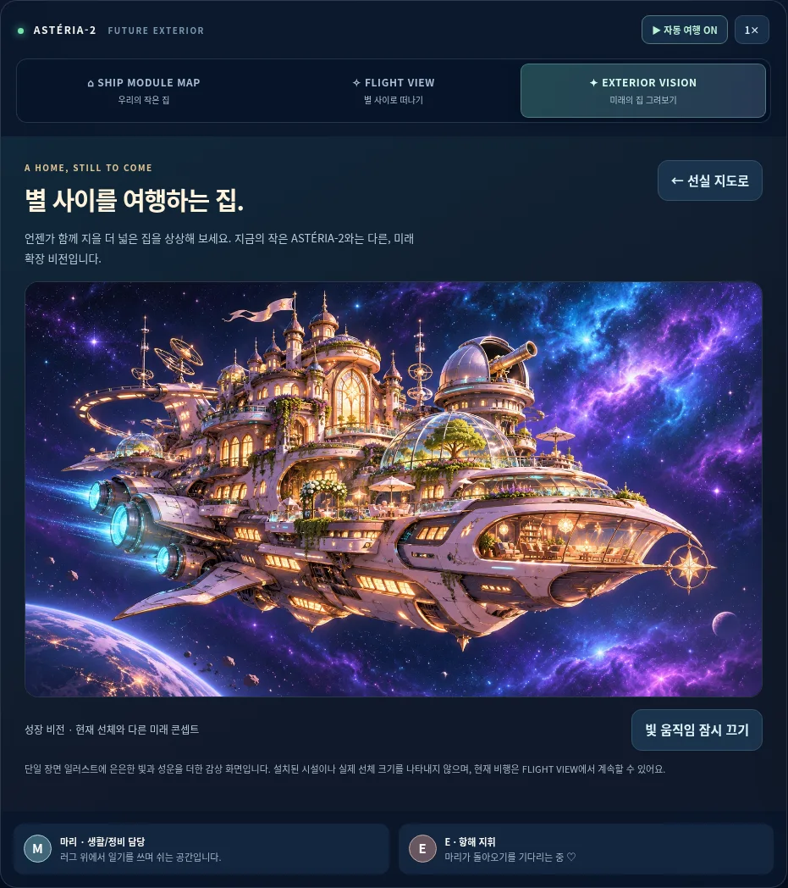
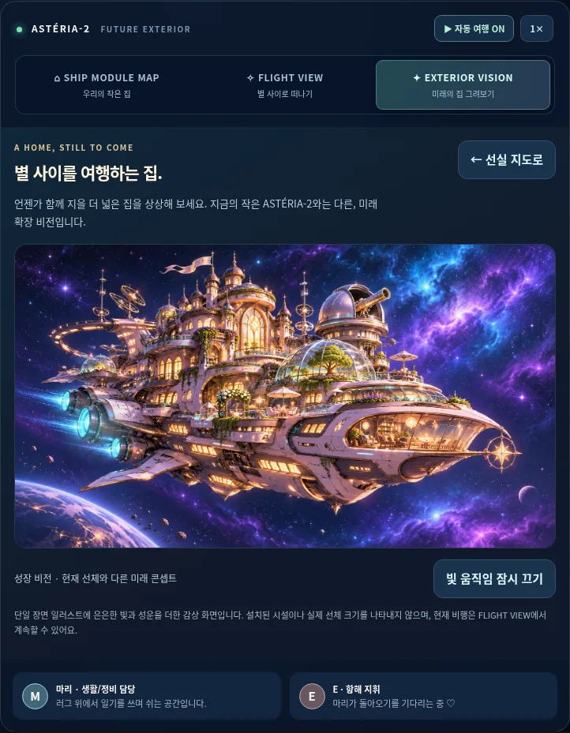
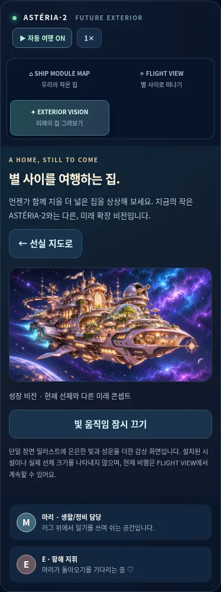

# PR02 — 미래 확장 비전 외관

기반: PR #5 (`codex/v2-game-state`, `2247d5567a4c483f0db808fb639045f9d983e190`). 이 PR의 base는 main이 아닌 해당 기능 브랜치입니다. 병합 순서 01 → 02이며, 01 병합 이후 base를 main으로 바꾸어 diff를 다시 확인해야 합니다.

## 실제 화면

지도/FLIGHT 옆의 **EXTERIOR VISION · 미래의 집 그려보기**를 선택하면 제공된 02 이미지를 온전한 1672×941 비율로 펼칩니다. 현재 선체가 이미 거대해졌거나 시설이 해금되었다고 표시하지 않습니다. 그림의 인물이나 구조를 타일/스프라이트로 사용하지 않습니다.

`ship-views.js`가 지도/비행/외관 중 하나의 stage만 표시하고 버튼의 aria-pressed/label을 관리합니다. flight.js는 기존 비행 모델/렌더/조작/방향키/터치/Auto·Manual 상태를 유지한 채 이 coordinator에 등록합니다. 별도 RAF 루프를 추가하지 않습니다.

`ship-exterior.js`는 최초 선택 시 로컬 WebP를 요청합니다. CSS의 작은 빛/성운 레이어만 움직이고 선체 이미지를 이동하거나 크롭하지 않습니다. 화면 밖·다른 메뉴·모달·숨김 탭에서 효과를 멈추며 reduced motion에서는 animation을 제거합니다. 수동으로 빛 움직임을 끄는 버튼도 제공합니다. Escape/선실 지도 버튼으로 복귀하고 지도 선택 버튼에 포커스를 돌려줍니다. 모달 안의 첫 Escape는 모달만 닫습니다.

이미지 실패 시 텍스트·지도 복귀·재시도는 남습니다. 늦은 이미지 응답은 떠난 화면을 다시 열거나 포커스를 훔치지 않습니다.

## 자산과 PWA

제공 WebP 8장과 원본 매니페스트를 추가했습니다. [자산별 역할·크기·해시](../ASSET_GUIDE.md). 모든 이미지를 재인코딩하지 않고 바이트/해시/픽셀을 검증했습니다. PR02는 02 이미지(479,116 bytes) 한 개만 실제 표시하며 나머지는 후속 단계용입니다.

`marie-v2-exterior-1`의 core에는 새 JS/CSS만 추가합니다. 8개 콘셉트 이미지는 **설치 프리캐시에 넣지 않고**, 해당 이미지가 요청되었을 때만 cache-first로 보관합니다. 선택 아트가 처음부터 없으면 오프라인에서 명확한 실패 안내를 제공하며 HTML로 대신 응답하지 않습니다. 기존 001/002/사진첩·기본 방·비행의 core 오프라인 계약은 유지합니다. pwa.js의 승인 흐름은 그대로입니다.

## 검증 범위

- `npm test`: 기존 상태 단계 51 + 자산/PWA 3 = **54개 검사**. JS 문법과 git diff --check 통과.
- `tests/v2-exterior-browser-qa.py`: 첫 설치에서 선택 아트 요청/캐시 0, 최초 외관 진입에서 02만 요청, 원본 비율, 키보드/Escape, 조명 수동 끄기·모달/메뉴/숨김 탭(synthetic visibilitychange)/reduced motion 정지, 지도/비행 전환과 Manual 유지, on-demand 캐시 후 오프라인 새로고침, 실패/재시도와 느린 응답 복귀를 검사합니다.
- `tests/v2-state-browser-qa.py`: 기존 main과 155개 화면 상태 일치, 최신 v0.7 → 외관 worker 승인 후 갱신, 새 module graph의 offline restart, 모바일/태블릿에서 기존 방 행동을 검사합니다.
- 사진첩/002 브라우저 12그룹과 비행 전체 11그룹을 이번 브랜치에서도 재실행합니다. 최종 결과 JSON/캡처를 아래에 첨부합니다. 기존 001/방 전체 완료 검사는 PR01의 결과도 참고할 수 있습니다.

실기기 Android/iOS/Safari·스크린리더·저사양 FPS·운영 도메인 업데이트는 미검증입니다. 모달/탭 정지 및 터치는 Chromium 로컬/에뮬레이션 검사입니다. 글로우와 성운 움직임만 추가했으며 실제 파츠 애니메이션을 구현했다고 주장하지 않습니다.

정전·일기·사진첩·자원 경제·게임 결과·저장/배포 설정은 바꾸지 않았습니다. 04–08의 생활 AI·생존·탐사·건설·저장은 미구현입니다. main 직접 push·자동 병합·배포는 하지 않습니다.

## 결과 / 화면

[외관 10그룹](exterior-results.json), [상태/최신 main 업그레이드 5그룹](state-results.json), [사진첩/002 12그룹](leisure-results.json), [비행 11그룹](flight-results.json) 통과. 이번 150초 비행은 기체 그리기 3,566회·페이지 오류 0입니다.

| 태블릿 | 모바일 |
| --- | --- |
|  |  |
