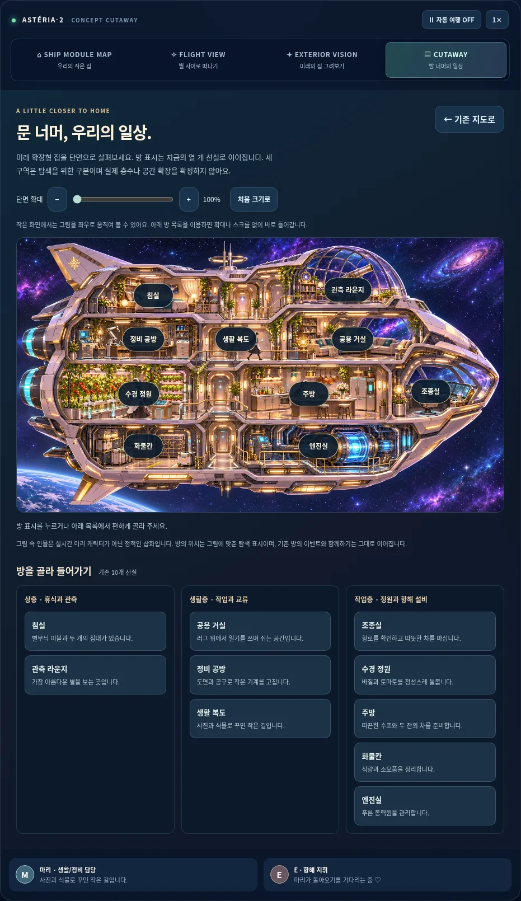
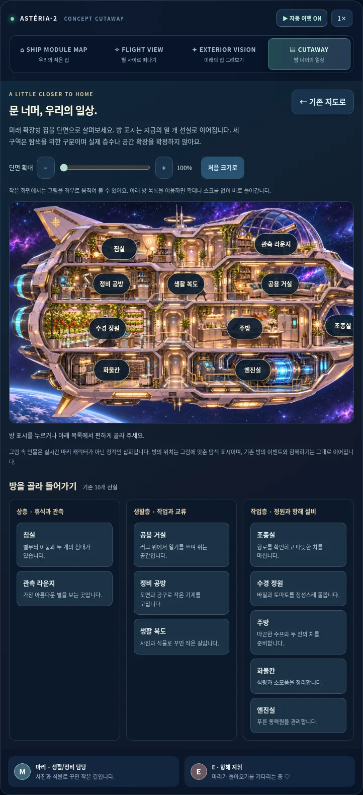
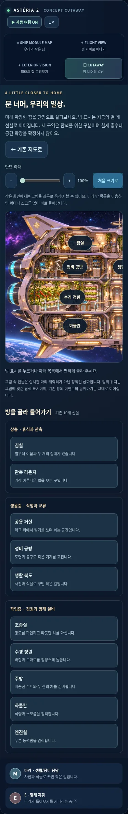

# PR03 — 단면도에서 기존 선실로

기반: PR #6 (`codex/v2-exterior`, `920573838210c9e7e3d6db110b4555c49527b017`). 의존 PR #5 → #6 → 이 PR 순서입니다. 앞 PR을 main에 병합한 뒤 다음 PR의 base를 main으로 바꾸고 diff를 확인해야 합니다. 이번 PR은 기능 브랜치에만 추가합니다.

## 구현된 동작

CUTAWAY를 선택하면 제공 03 WebP(1672×941, 580,640 bytes)를 실제 단면 탐색 화면으로 펼칩니다. 이미지 전체 구도는 유지하고 대략적인 방 위치에 DOM 버튼 10개를 직접 보정했습니다. 상층/생활층/작업층은 탐색을 위한 세 UI 구역입니다. 그림은 네 줄의 공간을 포함하며 구역 구분이 실제 층수/선체 크기/공간 확장 기구를 확정하지 않습니다.

기존 `ROOMS` 배열을 `game/rooms.js`로 그대로 옮겼습니다. ID/순서/소개/대사/기존 지도 좌표의 JSON 해시를 기준 main과 비교합니다. 게임 이벤트의 ROOM_IDS, app의 기존 지도/방, 새 단면 목록이 같은 카탈로그를 사용합니다. `game/ship-layout.js`에는 10개 ID의 위치/구역만 있습니다. 방 이름/미니게임 등록을 별도로 복제하지 않습니다.

새 단면의 모든 버튼은 기존 `openRoom`을 호출합니다. 원래 조감도의 10개 핫스팟, 방 함께하기, 다음 방, 10종 이벤트를 유지합니다. 그림 속 인물은 정적인 삽화이며 실제 캐릭터 행동 애니메이션이라고 표시하지 않습니다. 마리 생활 작업 큐·프레임 애니메이션은 후속 PR04 범위입니다.

좁은 화면은 780px 이상 폭의 단면을 가로 스크롤할 수 있고 100–200% 확대/축소와 초기화를 제공합니다. 큰 방 목록 10개를 따로 제공하므로 이미지 확대/스크롤이 어려워도 바로 방에 들어갈 수 있습니다. 브라우저 자체 확대를 막지 않습니다. 모바일 최소 그림 폭에도 배율을 적용하며, 다른 메뉴에서 화면 크기를 바꾼 후 복귀해도 현재 폭으로 다시 맞춥니다.

방을 닫으면 누른 핫스팟/목록 버튼으로 포커스가 돌아갑니다. 다음 방으로 이동해도 원래 진입점을 유지합니다. 일반 방 창에서도 Tab이 창 안을 순환하고, 미니게임이 열리면 기존 이벤트 컨트롤러가 포커스를 관리합니다. 기존 일반 닫기 바인딩에서 PWA backdrop을 제외해 pwa.js 자체 닫기 처리만 실행되도록 했습니다. 존재하지 않는 pwaModal을 일반 방 닫기에서 찾던 오류를 피합니다. pwa.js 파일은 변경하지 않았습니다. 첫 Escape는 게임 → 방, 두 번째는 방 → 단면, 다음 Escape는 단면 → 기존 지도입니다.

단면이 열릴 때만 이미지를 요청하며 #6의 optional-cache 정책을 재사용합니다. `marie-v2-cutaway-1` core에는 새 모듈/카탈로그/CSS만 추가합니다. 방문한 그림은 오프라인 재열기가 가능하고, 처음 방문하지 않은 오프라인 화면/이미지 실패 시에도 **기존 10개 방 목록**은 계속 작동합니다. 실패 시 빈 그림 영역을 접어 목록에 바로 접근할 수 있습니다. 느린 응답은 떠난 뷰를 다시 열거나 포커스를 이동하지 않습니다. PWA의 사용자 승인 갱신은 유지합니다.

## 검증

- `npm test`: **57개 검사**(기존 41 + 상태 10 + 자산 3 + 단면 3). JS 문법, git diff --check와 보존 대상 비교.
- `tests/v2-cutaway-browser-qa.py`: 10그룹. 원래 지도에서 얻은 방 제목/태그/이벤트 이름/이미지와 새 경로 20개를 비교합니다. 10개 게임 시작, Tab 순환, 계층별 Escape/포커스, 다음 방, 확대 버튼/키보드 range, 반복 뷰 전환, 오프라인 10개 시작, 태블릿/모바일 터치·스크롤·큰 목록, 이미지 실패·재시도/느린 응답을 검사합니다.
- 1440×900, 768×1024, 390×844와 가로 전환/reduced motion. 태블릿/모바일은 Chromium 에뮬레이션입니다.
- 최종 브랜치에서도 상태 155개 스냅샷 비교와 최신 main v0.7 → 신규 worker 승인 갱신/offline module graph, 외관 10그룹, 기존 사진첩/002·001·방 10종·비행 전체 회귀를 재실행하고 최종 JSON을 첨부합니다.

## 보존 경계 / 남은 단계

기존 001/002 본문·정전·매니페스트·이미지, 여가 사진첩 메타데이터/원본, 기존 일기 literal, 비행 물리/렌더와 방 게임 코드, pwa.js·CNAME·.nojekyll·manifest/icons는 기준 main과 같습니다. 자원/날짜의 기존 행동은 바꾸지 않습니다. 게임 상태와 작가의 고정 DAY/ETA를 혼합하지 않습니다.

04 생활 AI/정상 프레임 연출, 05 선택형 생존·생산/보상, 06 미션·연구, 07 설비 설치/해체, 08 명시적 로컬 저장/백업은 **미구현**입니다. 새 자산은 그 단계의 참고 자료로 보관하며 지금 모든 이미지가 작동하는 시스템을 표현하지 않습니다. 현재 생존 모드/저장 토글이 생겼다고 주장하지 않습니다.

외부 차단 사항은 없습니다. 이번 세 PR은 상태와 두 탐색 화면의 검토 가능한 경계로 제출하고, 위의 경제·저장 변경은 후속 단계로 남깁니다. 실제 Android/iOS/Safari·스크린리더·저사양 FPS·운영 도메인 설치/갱신은 미검증입니다. main 직접 push·병합·배포는 수행하지 않습니다.

## 결과 파일과 캡처

[단면 10그룹](cutaway-results.json) · [기존 main과 상태 155개 비교/업그레이드 5그룹](state-results.json) · [외관 10그룹](exterior-results.json) · [방 전체 19그룹](rooms-results.json) · [사진첩/002 12그룹](leisure-results.json) · [001 12그룹](voyage-results.json) · [비행 11그룹](flight-results.json)을 통과했습니다. 비행 회귀는 병렬 실행 중 렌더 시간 제한에 걸린 검사를 단독 재실행해 실제 수집/충돌/쿨다운·150초 연속 비행·오프라인을 확인했습니다. 게임 코드는 바꾸지 않았습니다. 최종 실경과 150초의 기체 그리기는 3,516회, 페이지 오류는 0이며 실기기 FPS 검사가 아닙니다.

모바일 확대 검사는 배율 표시뿐 아니라 실제 DOM 그림 폭의 25% 증가를 기다려 확인합니다. 태블릿/모바일 확대·축소·가로 전환·오류 복구와 전체 방 목록은 새 단면 테스트에 포함합니다.

| 태블릿 | 모바일 |
| --- | --- |
|  |  |
