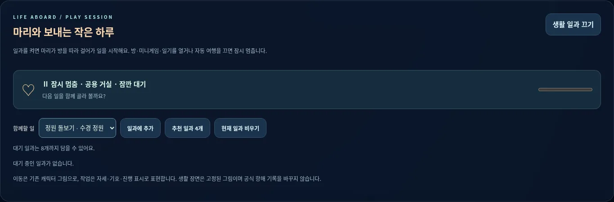
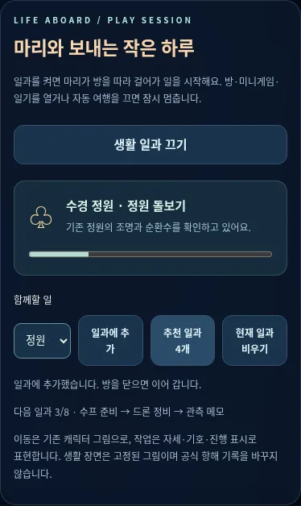

# PR04 — 마리의 생활 일과

기준 main `7581fbbcbc15fcdf87a9f17b31e539faf7046a21` (#5–#7 병합 후). 기본 생활 일과는 OFF이며 기존 힐링 조작을 유지합니다.

## 구현

`game/crew-ai.js`는 10개 방의 대칭 그래프/BFS 이동 경로, 최대 8개 대기 작업, idle/walk/garden/cook/repair/read/tea/record/rest/inspect 상태를 순수 함수로 계산합니다. 이동은 방 연결 한 구간당 2초, 작업은 8–12초입니다. 작업 완료 시 고유 ID의 CrewActionCompleted를 한 번 발행합니다. 이 단계의 완료 보상은 0이며 자원 경제는 다음 PR05 범위입니다.

`game/session.js`가 기존 상태 어댑터를 모든 UI에 공유합니다. app은 외부 전이를 구독해 수치·시계·항로·지도 표시를 갱신합니다. 기존 legacy transaction이 새 session 플래그를 버리지 않도록 보존합니다. 모델/어댑터 출력은 깊은 동결을 유지합니다.

`game/runtime.js`는 일과를 켰을 때만 단일 RAF를 시작합니다. 자동 여행 OFF/모달/기록 읽기/숨김 문서에서는 진행과 게임 시계를 멈추고 복귀 시 누적 시간을 보충하지 않습니다. 작업 중 방을 카메라로 열어도 마리를 순간 이동시키지 않습니다. 현재 위치/작업을 별도로 표시하고 해당 방에 있을 때만 캐릭터 오버레이를 보여 줍니다. 방의 함께하기는 해당 작업을 큐에 넣고, 미니게임 입력은 기존 컨트롤러가 관리합니다.

4개 제공 WebP를 정원/주방/공방/관측실의 **생활 장면 보기**로 실제 사용합니다. 기본 방 배경으로 즉시 복귀할 수 있고 실패하면 기존 이미지를 사용합니다. 정지 그림임을 명시하며 단일 장면을 애니메이션 프레임으로 자르지 않았습니다. 원본 해시/픽셀은 그대로입니다. 선택 이미지 캐시 정책을 재사용합니다.

캐릭터는 기존 `assets/sprite.svg`의 128×156 네 프레임을 이동에 임시 재사용합니다. 작업은 정지 자세와 작업별 기호/CSS 효과/진행률로 구별합니다. 실제 손동작/4방향 신규 아틀라스를 완성했다고 주장하지 않습니다. reduced motion에서는 캐릭터/기호 애니메이션과 부드러운 이동을 생략하되 논리 시간은 같습니다.

## 검증

- 기존 57 + 신규 순수 모델 6 = **63개 검사 통과**, JS 문법/diff 검사.
- [생활 브라우저 8그룹](crew-results.json): 실제 네 작업, room/pose/dialogue/이벤트 일치, 이동 후 작업, 3가지 일시정지, 큐 비우기/초과 복구, 4개 배경/원본 복귀, 이미지 실패, tablet/mobile touch와 reduced motion, 현재 main SW → 신규 SW 승인 갱신 및 001/002/4:3 사진 연결의 offline 회귀.
- 기존 main과의 155개 UI 상태 비교와 기존 제어/offline 회귀는 [기본 동작 검사](parity-results.json)에 기록합니다. 기본 일과 OFF 상태의 수치/시계/지도/대사/피드가 같습니다.
- 새 core JS/CSS는 `marie-v2-crew-1`에 포함하며 콘셉트 WebP는 방문할 때만 캐시합니다. 사용자 승인 흐름은 유지합니다.

실제 Android/iOS/Safari·스크린리더·저사양 FPS·운영 도메인 업데이트는 미검증입니다. 브라우저 검사는 Chromium 1440×900, 768×1024, 390×844 에뮬레이션입니다.

정적 001/002 정전/본문/이미지·사진첩/기존 일기 literal, 비행/방 게임 모델, pwa.js, 배포 설정은 보존합니다. 신규 대화 업로드/계정/API/브라우저 저장은 없습니다. main 직접 push·병합·배포는 하지 않습니다.

| PC | 모바일 |
| --- | --- |
|  |  |
