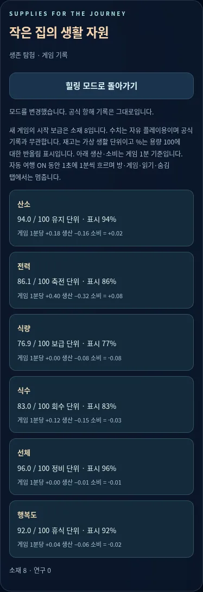

# PR05 — 선택형 생존 자원

Depends on PR #8 (`codex/v2-crew-life`, `6179b38f14d81002c8117b26877e573959e45048`). 기본은 기존 힐링이며 사용자가 영향 설명을 확인해야 생존 탐험 모드로 전환합니다.

## 자원 규칙

재고는 0–100 가상 생활 단위, 기존 HUD는 용량 100에 대한 반올림 %입니다. 표시와 내부 소수 재고를 구분하며 버튼/위치/속도 변경이 소수 재고를 지우지 않습니다. 시간은 활성 게임 화면에서 약 1초당 게임 1분, 속도 버튼 1/2/4배입니다. 방·미니게임·기록 읽기·다른 메뉴·숨김 탭·자동 여행 OFF는 생활 진행을 멈추고 복귀 시 catch-up하지 않습니다.

| 재고 | 기본 생산/분 | 기본 소비/분 |
| --- | ---: | ---: |
| 전력 | .40 | .32 |
| 산소 | .18 | .16 |
| 식량 | 0 | .08 |
| 식수 | .12 | .15 |
| 선체 | 0 | .01 |
| 행복도 | .04 | .06 |

기본 전력은 발전−부하, 산소는 생명유지−승무원 사용/누출, 식량은 수확/반입−소비, 식수는 회수−사용, 선체는 수리−피해, 행복도는 휴식−생활 소비를 순수 계산합니다. 후속 설비는 이 생산/소비에 연결합니다. 생존 새 게임은 소재 8로 시작하며 모드 재선택은 새 보급을 지급하지 않습니다. 자유 플레이 수치이며 공식 DAY/거리/ETA와 무관합니다.

재고 25 이하 경고, 10 이하 생활 시간 정지 → 긴급복구/힐링 복귀 선택입니다. 강제 게임 오버가 없습니다. 긴급복구는 부족한 재고를 35로 올려 시간을 재개하며 게임 30분 cooldown을 둡니다. 힐링 복귀는 기존 15–100/반올림과 자동 회복으로 되돌리고 연구/소재를 보존합니다.

## 실제 보상 연결

room-events는 새 판마다 고유 ID를 만들고 첫 결과에서만 결과 이벤트를 보냅니다. reducer의 처리 ID도 중복을 막습니다. 생존 성공은 방별 공개 규칙과 소재/연구 각 +1, 실패/중단은 차감하지 않습니다. 정원 성공은 식량 +4, 산소 +1, 식수 −1, 전력 −1(재고 최대 100)입니다. 힐링 결과는 자원을 바꾸지 않으며 수령 ID만 남겨 뒤늦은 생존 전환 후 재지급을 막습니다. 재시도는 새 판이고 이전 결과를 다시 지급하지 않습니다.

기존 미니게임의 물리/승패/그림과 메인 Flight의 독립 모델은 바꾸지 않았습니다. 주 비행의 거리/보호막은 생활 재고와 별도이며 단순 화면 재진입으로 보상을 받지 않습니다. 공식 정전/일기는 수정하지 않습니다.

## 검증 / 제한

- 기존 63 + 자원 모델 8 = **71개 검사**. 시간 분할 결정성, 소수 재고, 모드 경계, 0–100/15–100, garden 보상/중복/실패/힐링 재플레이, 위기/복구/cooldown, 비용 부족 원자성을 확인합니다.
- [생존 브라우저 결과](survival-results.json): 명시적 동의/취소, 실제 재고 시간 진행, 정원 게임 완주와 실제 보상, 동일 결과 재전송/재시도, critical 재고 fixture의 복구/안전 복귀, 모바일/태블릿, 최신 main SW 승인 갱신과 offline 초기화.
- [기본 힐링 155개 스냅샷/회귀 5그룹](parity-results.json). 기존 기본 모드가 일치합니다.
- `marie-v2-survival-1`, 신규 모듈 core 추가, 콘셉트 아트는 선택 캐시, 기존 사용자 승인 갱신 유지. JS 문법/diff 검사.

브라우저는 Chromium 1440×900/768×1024/390×844입니다. 실기기 Android/iOS/Safari·스크린리더·저사양 성능·운영 배포는 미검증입니다. 생존 시간은 렌더 간격을 제한해 긴 백그라운드 간격을 누적하지 않으므로 실시간 물리 시계가 아닙니다.

고정 001/002와 사진첩/일기 literal, 모든 원본 자산, 기존 게임 모델, pwa.js·배포 설정 보존. API/계정/원격 전송/저장 기능 없음. main 직접 push·병합·배포 없음.

| PC | 모바일 |
| --- | --- |
|  |  |
