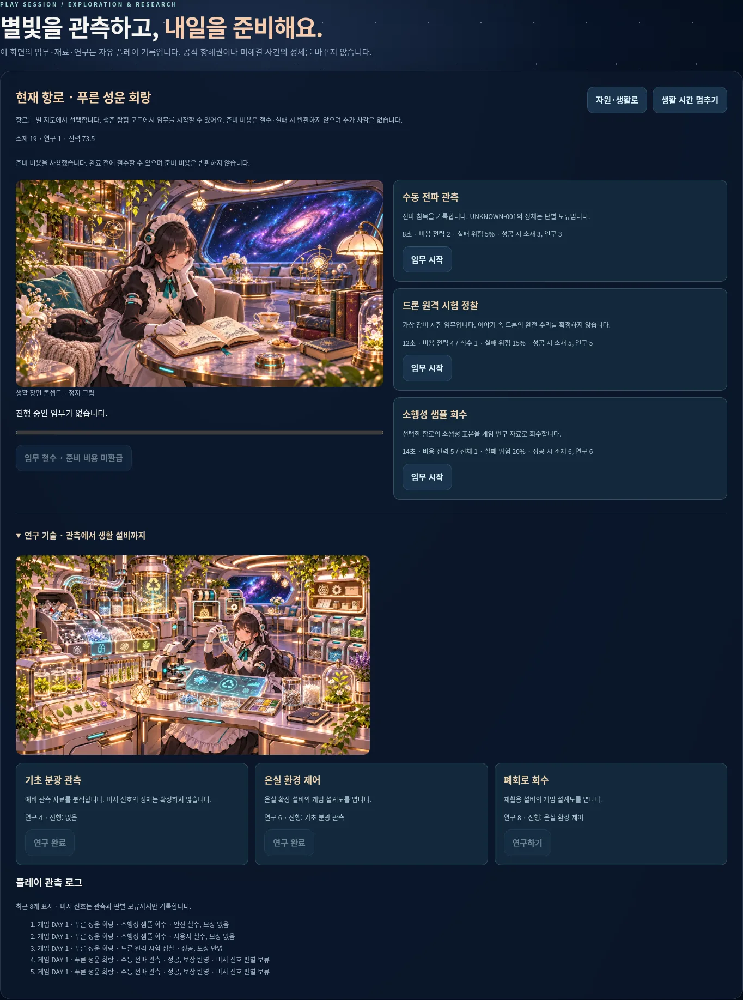
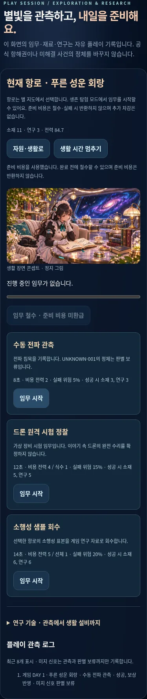

# PR06 — 탐사와 연구

Depends on PR #9 / `codex/v2-survival` (`1f18e6bf288007ec1bd9ba3510746cb5c6cf35ae`). 기존 세 항로의 ID/문구/순서를 공유 routes 모듈로 옮겼습니다. 새 탐사·연구 메뉴는 기존 지도/방/비행/일기와 별도로 열립니다.

## 플레이 규칙

생존 모드에서 현재 항로의 임무를 선택합니다. 수동 관측 8초(전력 2), 드론 시험 12초(전력 4/식수 1), 샘플 회수 14초(전력 5/선체 1)입니다. 초기 준비 비용은 실패/철수 시 미환급이며 추가 피해는 없습니다. 성공 시 소재/연구는 각각 3/3, 5/5, 6/6입니다. 기본 실패 위험은 5/15/20%, 황금 고리 +5%p, 오로라 얼음 +10%p입니다. 시작 전에 비용/시간/위험/보상을 표시합니다.

동시에 한 임무만 진행하고 안전 재고 10 초과를 남겨야 합니다. 시간/숨김 탭/모달 pause는 생활 런타임을 공유합니다. 난수 표본은 순수 모델 인수로 주입하고 시작 시 결정합니다. 임무 ID/처리 영수증·상태 종결을 통해 중복 보상을 막습니다. 진행 중 모드 변경은 먼저 철수해야 합니다.

기초 분광 관측(4점) → 온실 환경 제어(6점) → 폐회로 회수(8점) 세 연구를 선행/포인트 검사 후 해금합니다. 2·3단계 설계도는 후속 건설에 연결합니다. 연구 비용은 한 번 차감하고 중복 연구를 막습니다.

05 공방 그림은 드론 시험 장면, 06 관측 그림은 관측/샘플, 08 연구 그림은 연구 섹션에서 실제 사용합니다. 전부 정지 콘셉트이고 필요할 때만 요청합니다. 그림 실패에도 모델/조작은 작동하고 임무 이미지는 기존 관측실로 복귀합니다.

플레이 로그는 최근 24개 보관/8개 표시합니다. UNKNOWN-001은 관측·판별 보류까지만 표시하고 드론 완전 수리를 확정하지 않습니다. 공식 001/002/사진첩을 읽거나 쓰지 않습니다.

## 검증

- 기존 71 + 미션/연구 순수 모델 6 = **77개 검사**. 비용 부족 원자성, 세 항로 위험, 성공/실패/철수, 시간 분할, 중복 방지, 선행 연구/중복 해금 검사.
- [실제 브라우저 7그룹](exploration-results.json): 모드 잠금, 두 실제 임무와 포인트·두 연구 해금, 시간 정지, 철수/실패/뷰 재진입, 세 그림 실제 사용, tablet/mobile과 offline worker upgrade.
- [기본 동작 155개 비교/회귀 5그룹](parity-results.json). JS 문법/diff 검사.
- `marie-v2-exploration-1`, 새 코드 core/원본 그림 선택 캐시, 사용자 승인 기반 SW 업데이트 유지.

Chromium 1440×900/768×1024/390×844 기준입니다. 실제 Android/iOS/Safari·스크린리더·저사양 성능·운영 배포는 미검증입니다. 실패는 안전 철수로 표현하고 임무 준비 비용만 소비합니다. 임무는 게임 분기이며 실제 세계관 발견/설비 시험 결과가 아닙니다.

main 직접 push·병합·배포 없음. 정전/기존 일기/사진첩·원본 자산·기존 게임 모델·pwa.js·배포 설정 보존. 새 API/계정/저장 기능 없음.

