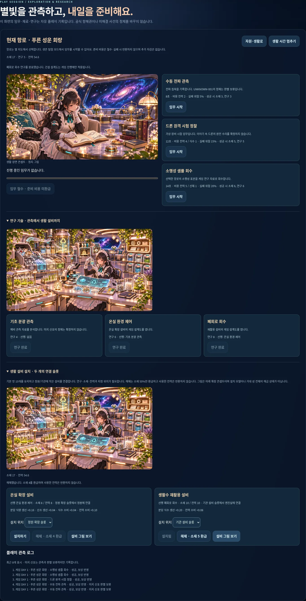

# PR07 — 생활 설비 설치와 해체

Depends on PR #10 / `codex/v2-exploration` (`f495e9fd92ba028a931c1acee91b31161e8c989b`). 기본 10개 방을 유지하며 별도 정원/기관 연결 슬롯에 설비를 설치합니다.

| 설비 | 선행 | 소재/전력 | 위치/연결 | 분당 효과 |
| --- | --- | --- | --- | --- |
| 온실 확장 | 온실 환경 제어 | 8 / 8 | garden-port / garden | 식량 생산 +.16, 산소 생산 +.04, 식수 소비 +.04, 전력 소비 +.10 |
| 생활수 재활용 | 폐회로 회수 | 10 / 10 | engine-port / engine | 식수 생산 +.20, 전력 소비 +.08 |

설치 전 모드/연구/소재/전력/안전 예비 재고/위치/기본 방 연결/슬롯 점유/중복 설치를 검증합니다. 실패는 원자적이며 비용을 차감하지 않습니다. 설치 후 재고의 실제 생산·소비와 지도/단면/외관의 게임 설비 표시를 같은 상태에서 즉시 갱신합니다.

해체는 소재 50%(4/5)를 환급하며 이미 소비한 전력은 반환하지 않습니다. 중복 환급과 재설치 순환을 통한 자원 증식을 막습니다. 기본 방이나 그 게임은 제거하지 않습니다.

07 격납고/확장 그림을 건설의 대표 장면, 01 정원/08 재활용을 개별 프리뷰로 실제 사용합니다. 그림은 미래 콘셉트이며 설치 가능한 파츠 모델/전체 우주 성 해금이라고 표시하지 않습니다. 동적 실제 설치는 별도 DOM 배지와 생산 표입니다. 지연 로드/선택 캐시/그림 실패 시 조작 유지가 가능합니다.

## 검증

- 기존 77 + 건설 모델 6 = **83개 검사**. 비용·연구·잘못된 슬롯/연결·부족·중복·점유·실제 수급·환급·원본 불변성.
- [브라우저 7그룹](building-results.json): 실제 UI로 탐사→연구 세 기술→두 설비 설치, 잘못된 슬롯 원자성, 실제 식량 증가와 전력 소비표, 3뷰 배지, 해체/중복 환급 방지, 태블릿/모바일 실제 설치, 최신 main SW 승인 갱신과 offline 코드/선행 조건 오류.
- 신규 모듈 core/원본 그림 선택 캐시, `marie-v2-construction-1`. JS 문법/diff 검사. 기존 기본 동작 비교는 선행 PR06 결과와 최종 PR08의 통합 회귀에서 확인합니다.

Chromium 1440×900/768×1024/390×844 기준입니다. 실제 Android/iOS/Safari·스크린리더·저사양 성능·운영 배포는 미검증입니다. 신규 실시간 파츠 아트/3D 모델/캐릭터 아틀라스를 완성했다고 주장하지 않습니다.

공식 정전/001/002/사진첩·원본 자산·기존 게임 모델·pwa.js·배포 설정은 보존합니다. 저장은 다음 PR08의 명시적 선택 사항입니다. main 직접 push·병합·배포는 수행하지 않습니다.

