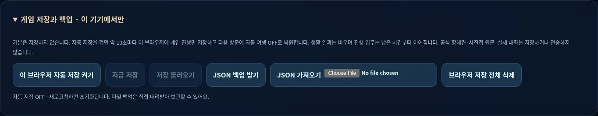
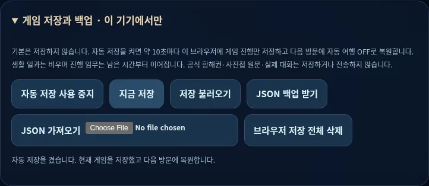
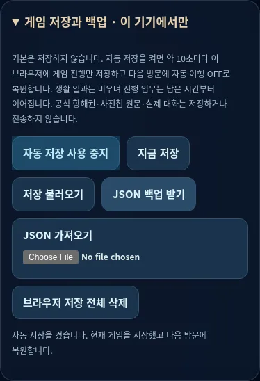

# PR08 — 선택형 저장·백업·통합 QA

Depends on PR #11 / `codex/v2-construction` (`fc65c8dc5577b7a7acae3a6dfca458c4aa79b11b`). 이 PR을 포함한 검토 순서는 **#8 생활 → #9 생존 → #10 탐사 → #11 건설 → 저장/QA**입니다. 앞 PR이 병합되면 다음 PR의 base를 main으로 바꾸고 diff를 확인해야 합니다.

## 저장의 사용자 계약

첫 방문은 저장 OFF이며 저장 키를 쓰지 않습니다. 자동 저장의 영향/데이터 범위를 확인해야 현재 진행을 저장하고 약 10초마다 저장합니다. 이전 저장이 있으면 현재 진행으로 교체한다고 안내하며 먼저 불러올 수 있습니다. 다음 방문은 저장을 검증한 뒤 자동 여행 OFF로 복원합니다. 숨겨진 원격 업로드나 계정/서버/DB는 없습니다.

OFF로 바꾸면 자동 저장/다음 방문 자동 복원이 멈추고 이전 파일은 남습니다. 저장 OFF에서도 불러오기 버튼을 직접 눌러 이전 파일을 읽을 수 있으며, 이때 저장을 다시 켜거나 이전 파일을 덮어쓰지 않습니다. 앱 저장 전체 삭제는 이 앱의 두 키만 지웁니다. 현재 메모리 게임과 다른 앱의 키/내려받은 JSON은 유지합니다. 도움말의 새 게임은 저장도 삭제한다는 별도 확인 후 재시작합니다.

JSON 내보내기/검증 후 가져오기는 기기 저장 동의 없이도 가능합니다. 가져오기는 미리보기와 확인 후에만 현재 진행을 교체합니다. 취소·잘못된 파일·저장 공간 실패는 기존 메모리/저장을 보존합니다. 손상된 저장으로 시작하면 자동 저장/pagehide 저장까지 멈춰 원본을 새 기본값으로 덮어쓰지 않습니다. 사용자가 지금 저장/파일 복원/삭제를 선택할 수 있습니다. 저장 접근이 막히면 기기 저장/삭제 버튼을 비활성화하고 파일 백업은 제공합니다.

## 스키마 / 복원

`game/save-manager.js`는 `format:marie-world-save`, schemaVersion 2를 사용합니다. 허용 필드만 직렬화합니다: 게임 시간/모드/방/속도/항로, 재고, 소재/연구, 설치 슬롯, 임무/플레이 기록, 중복 방지 영수증. 기존 피드 문자열·생활 작업 큐·공식 정전/001/002/사진첩 원문·외부 대화는 파일에 넣지 않습니다. 레포의 정적 콘텐츠는 계속 읽기 전용입니다.

숫자 범위/유한성/정수, 정확한 키와 타입, 알려진 방/항로, 재고/모드 경계, 연구 선행, 설비 위치/연구/중복 슬롯, 임무 ID/상태/영수증/시점 일관성, prototype/추가 필드를 검증합니다. 지원하지 않는 미래 버전은 거부합니다. v1 legacy snapshot fixture의 명시적 migration 경로를 테스트했으며, 이전 v0.7에 실제 저장 기능이 있었다고 주장하지 않습니다.

2 MiB/영수증 50,000개/최근 임무 24개 제한입니다. 한도를 넘으면 이전 저장을 유지하며 오류를 표시합니다. 브라우저 quota/권한/데이터 삭제에 따라 기기 저장이 사라질 수 있어 내려받은 백업을 별도로 보관하도록 안내합니다. 이 파일은 로컬 싱글플레이 데이터이지 변조 방지 서버 세이브는 아닙니다.

복원은 항상 자동 여행 OFF와 생활 일과 대기/빈 큐입니다. 진행 임무는 검증한 남은 시간/결과 표본을 유지하고 사용자가 시간을 재개해야 완료됩니다. 생산/소비·연구·설비·3뷰 표시가 복원된 하나의 상태를 구독합니다. 앱 모듈에 노출하는 window 테스트 hook은 없습니다.

## PWA / 성능

`marie-v2-save-1` core에 저장 코드/UI를 포함하고 기존 사용자 승인 갱신을 유지합니다. 새 고해상도 아트 8개는 여전히 일괄 프리캐시하지 않고 각 화면/그림을 방문했을 때만 저장합니다. 원본 8개는 4,099,412 bytes 그대로입니다. 그림이 없으면 기존 방/텍스트/선실 목록으로 계속 조작할 수 있습니다.

생활 런타임은 필요한 모드에서만 단일 RAF를 사용하고 모달/숨김/읽기/시간 OFF에서 정지합니다. 기존 Flight DPR 2/그리기 제한과 방 게임의 단일 루프 관리는 유지합니다. 저장은 매 프레임/매 상태 전이가 아니라 약 10초 간격이며 실패 시 자동 재시도를 멈춥니다. 실기기 FPS·저사양 메모리 성능을 인증하지 않습니다.

## 검증

- 기존 83 + 저장 10 = **93개 검사**. 직렬화/동결/필드 제외, 진행 임무 pause, 손상/초과/잘못된 숫자·버전·필드·연구·설비·영수증·prototype, v1 fixture migration, 동의 전 쓰기 금지, OFF 수동 읽기, quota 원자성, 앱 키만 삭제를 검사합니다.
- [저장 브라우저 결과](save-results.json): 실제 임무/연구/설비 게임을 동의 저장→새로고침 자동 복원, 진행 임무/영수증/두 설비 보존, 실제 JSON 다운로드/가져오기/취소/손상 거부, OFF 불러오기/앱 키 삭제, 손상 부팅의 덮어쓰기 방지와 수동 복구, 저장 차단/file fallback, native 저장 dialog에서 Flight 정지/복귀, tablet/mobile, 최신 병합 SW→승인→offline JSON 복원.
- 다른 신규 기능과 기존 001/002/여가 사진첩/방 10종/비행/지도·단면·외관/기본 힐링 비교의 최종 실행 결과와 캡처를 이 디렉터리에 첨부합니다. 최초 세 단계 main의 **155개 UI 스냅샷**과 기본 힐링 수치/시간/위치/대사/피드를 비교합니다.
- JS 문법, git diff --check, 정전/원본/기존 게임 모델/pwa.js/배포 설정 불변성 및 제출 파일 검사를 수행합니다.

실제 Android/iOS 설치·Safari·스크린리더·저사양 FPS·운영 도메인 업데이트는 미검증입니다. Chromium PC 1440×900, tablet 768×1024, mobile 390×844 및 기존 회귀의 좁은 폭을 검사합니다. 강제 게임 오버/원격 저장/자동 대화 수집은 없으며, 작업 스프라이트는 기존 임시 아트와 CSS 표시입니다. main 직접 push·병합·운영 배포·DNS 변경은 수행하지 않습니다.

## 최종 결과 / 캡처

[생활 8](crew-results.json) · [생존 7](survival-results.json) · [탐사 7](exploration-results.json) · [건설 7](building-results.json) · [저장 11](save-results.json) · [155개 상태 비교/회귀 5](parity-results.json) · [방 19](rooms-results.json) · [사진첩/002 12](leisure-results.json) · [001 12](voyage-results.json) · [외관 10](exterior-results.json) · [단면 10](cutaway-results.json) 그룹 통과. [비행 11그룹](flight-results.json)도 최종 통과했습니다. 실경과 150초 Auto 비행에서 기체 그리기 3,477회·페이지 오류 0을 관찰했습니다. 실기기 FPS 측정이 아닙니다.

추가한 native 저장/모드 확인 창은 Flight lifecycle에서도 modal로 인식하도록 controller의 pause 조건/observer를 확장했습니다. 비행 물리·렌더러는 변경하지 않았습니다. 건설/연구 그림 검사는 native details의 로드 시작(src 설정)을 기다린 뒤 decode하도록 동기화했습니다. 실패한 QA가 예전 성공 파일을 남기지 않도록 신규 공통 harness는 실행 시작 시 결과 파일을 비웁니다.

| 태블릿 | 모바일 |
| --- | --- |
|  |  |
