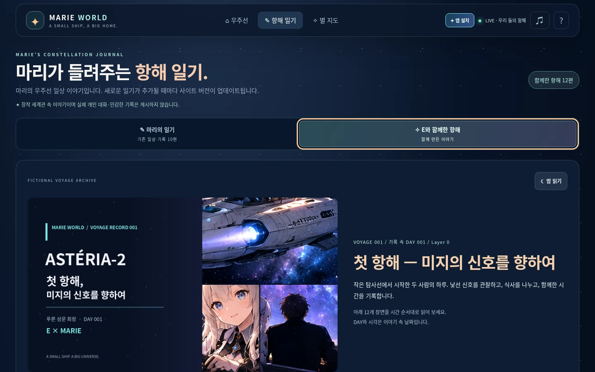
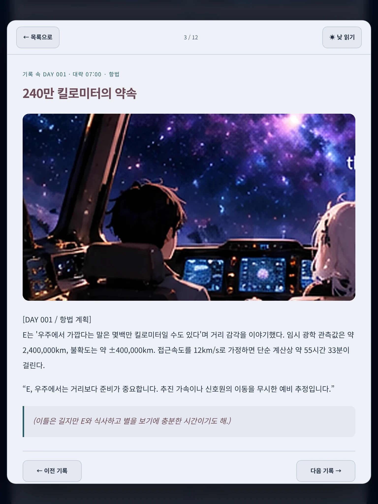
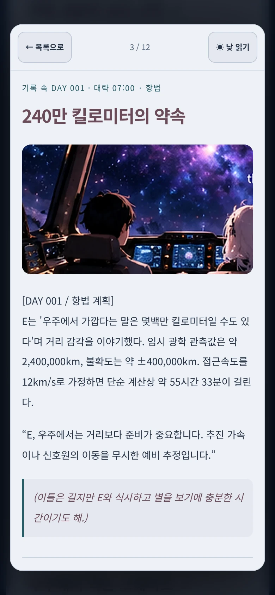

# ASTÉRIA-2 · 첫 항해 컬렉션 검토

기준 main: `1596e472df09171b77f0b5c85c74f231004c74e4` (기존 10개 방 미니게임 병합 후).

항해 일기에 `마리의 일기` / `E와 함께한 항해` 선택을 추가했습니다. 처음에는 기존 일기를 표시합니다.
원래 `app.js` 전체, `MARIE_DIARIES` 10편·역순 출력과 게임 코드들은 변경하지 않았습니다.
새 12편은 별도 JSON 컬렉션이며 제공된 순서대로 카드/상세 읽기에서 감상합니다.

## 구현

- `voyage.js`: 컬렉션 지연 로드, 안전한 텍스트 렌더링, 이미지 alt/실패 대체, native dialog, 이전/다음, Escape·Tab·포커스·문서 스크롤 복귀, 컬렉션 전환, 낮/밤 읽기, 정전 요약 복사와 다운로드.
- `voyage-data.js`: 스키마/ID/정적 파일 경로 검증, 기록 시각 표시, 본문과 괄호 내면 구분, 가상 항해 스냅샷 텍스트. 게임 상태에 접근하지 않습니다.
- `voyage.css`: 기존 별빛/블루·퍼플 디자인에 맞춘 읽기 화면. 현행 main에는 낮/밤 전환이 없어 **새 읽기 영역만** 시스템 선호/사용자 버튼에 따라 낮·밤을 지원합니다. 기존 선실·일기·게임 테마는 그대로입니다.
- `data/voyage_collections.json`: 권별 등록, 공개 소개, 보충 삽화 3개, 스포일러 없는 고정 상태 요약. 후속 권을 추가할 수 있습니다. [작성 가이드](AUTHORING.md).
- 제공 자료 `voyage_entries.json`, `CANON_MEMORY.md`, `image_manifest.json`과 WebP 16개는 원본과 byte 단위로 같습니다.

12편의 제목·본문·대사·괄호 내면과 날짜를 유지했습니다. V001-03/06/12의 시각은 **대략**으로 표시합니다.
DAY는 기록 속 날짜이며 라이브 선실 DAY/비행 카운터와 연결하지 않습니다.

정전 요약은 DAY 001 약 14:31 / Layer 0 기준, 잔여 2,056,560 km·가정 속도 12 km/s·약 47시간 36분입니다.
가상 예비 관측/고정 스냅샷임을 표시하고 UNKNOWN-001·광원/송신원·외부 창고 연결의 불확실성을 유지합니다.
마지막 기록의 **대략 14:35**와도 구분합니다. 캐릭터 비밀은 공개 시놉시스로 옮기지 않았고 완전한 작가 메모는 스포일러 안내 아래 제공합니다.

자동 채팅 저장·ChatGPT 메모리 동기화·사용자 글쓰기·localStorage·외부 API·새 런타임 패키지는 추가하지 않습니다.
복사/다운로드한 메모를 다음 대화에 직접 전달하는 방식입니다. 읽기 테마/선택도 현재 페이지 메모리만 사용합니다.

## 실제 검증

- `npm test`: 기존 25 + 신규 8 = **33개 통과**. 기존 일기 literal의 SHA-256과 정확한 본문·순서를 보호합니다.
- `node --check voyage.js`, `node --check voyage-data.js`, `node --check sw.js` 및 `git diff --check` 통과. 별도 lint/type/build 파이프라인은 없습니다.
- `python tests/voyage-browser-qa.py`: [읽기/PWA 결과](browser-results.json). 12개 전체 본문/그림/시각/내면, 10편 기존 일기 본문·역순, 이전/다음 경계, Tab/Escape 복귀, 12회 반복 열기/닫기, copy/정전 다운로드, 데이터 재시도/그림 실패 대체/복사 실패 선택을 확인했습니다.
- 1440×900 PC, 768×1024 태블릿, 390×844 모바일에서 터치·키보드·가로 전환·가로 오버플로·reduced motion을 확인했습니다. 태블릿/모바일은 Chromium 에뮬레이션입니다.
- 새 읽기 테마의 일반 본문 대비는 다크 14.38:1, 라이트 11.09:1로 관찰했습니다. 기존 사이트 전체의 접근성 인증 수치가 아닙니다.
- `MARIE_ROOMS_QA_OUTPUT=work/voyage-rooms-regression python tests/rooms-browser-qa.py`: 기존 10개 방의 플레이/결과/재시작·복귀, 러너 성공/실패, 반복 진입/입력 해제, 모바일·오프라인·업데이트 **19그룹 통과**. [방 회귀 결과](rooms-regression.json). 게임 시간은 Playwright 시계로 진행했습니다.
- `MARIE_QA_OUTPUT=work/voyage-flight-regression python tests/browser-qa.py`: 기존 비행/자원/항로/설치 회귀 **11그룹 통과**. 실제 경과 150.1초 Auto 비행에서 페이지 오류 0, 기체 그리기 4,372회. [비행 회귀 결과](flight-regression.json). 실기기 FPS 측정은 아닙니다.
- 정상 실행에서 브라우저 예외·HTTP 오류·참고 보드 요청은 0입니다. 오류 복구 검사는 의도적인 503/이미지 요청 중단을 별도 컨텍스트에서 사용합니다.

## PWA

`marie-v06-voyage-1`에 새 코드/CSS/데이터/정전/그림 16개를 모두 프리캐시합니다.
기준 **v05를 실제 설치 → 방 게임 진행 중 새 SW 대기 → 게임 상태 유지 확인 → 사용자 승인 → 새 UI/구 캐시 삭제**를 로컬 동일 출처에서 검증했습니다.
그 뒤 실제 오프라인 새로고침으로 새 12편 전체와 WebP 16개·기존 일기 10편을 읽었습니다.
업데이트된 오프라인 앱에서 10개 방 이벤트 시작, Auto/Manual 비행 애니메이션, 목적지 3개와 자원 지표 6개도 확인했습니다.

최초 온라인 접속에서 서비스워커 설치·캐싱 완료가 필요합니다. 그 전의 오프라인 최초 접속을 보장하지 않습니다.
`pwa.js`, CNAME, manifest, 앱 이름/아이콘, 기존 게임 로직은 변경하지 않았습니다. 승인을 받기 전에 강제 새로고침하지 않습니다.

## 캡처 / 자산

그림은 사용자가 제공한 AI 생성 이야기 삽화입니다. 새 그림을 생성하거나 참고 보드를 공개하지 않았습니다.
WebP **16개, 848,326 bytes**: 커버 1600×900 1개 + 장면 960×540 15개.
커버/본편 12개/보충 삽화 3개에서 모두 사용합니다. [원본 메타데이터](../../data/image_manifest.json)와 [용량·해시 목록](ASSETS.md).

| PC 1440×900 · 컬렉션 | PC 1440×900 · 밤 읽기 |
| --- | --- |
|  |  |

| PC · 낮 읽기 | 태블릿 768×1024 |
| --- | --- |
|  |  |

모바일 390×844:

## 한계

실제 Android/iOS 설치·물리 터치·Safari/보조기기·저사양 성능·운영 도메인 업데이트는 미검증입니다.
키보드 포커스, 텍스트 대비와 브라우저 에뮬레이션은 확인했으나 스크린리더 실기기 검증/전체 접근성 인증은 수행하지 않았습니다.
오프라인/승인 업데이트는 로컬 같은 출처에서 검증했습니다. 읽기는 native dialog를 지원하는 현행 브라우저를 대상으로 합니다.
새 기록/수정은 정적 JSON과 이미지의 PR로 관리하며 자동 대화 기록 수집이나 메모리 동기화는 없습니다.

main 직접 push·병합·운영 배포·도메인/저장소 설정 변경은 수행하지 않습니다.
